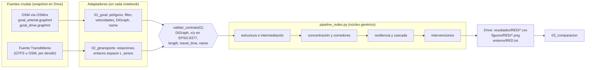

# Propuesta de arquitectura: pipeline común para Gvial y Gtransporte

Documento de diseño. Revisa el notebook del avance frente a `docs/proyecto.md` y propone cómo reutilizarlo para TransMilenio sin duplicar código. No modifica el notebook.

Convención: **[H]** es un hecho observado en el notebook o en los documentos del repo. **[I]** es una inferencia que el equipo debe confirmar.

## 1. Contexto y restricciones

| Variable | Valor en este proyecto |
|---|---|
| Consumidor | El profesor del curso, que evalúa claridad metodológica y reproducibilidad |
| Horizonte | Un semestre. Dos redes (Gvial y Gtransporte) y una comparación |
| Frecuencia | Pocas corridas completas: línea base, refactor, Gtransporte, informe |
| Volumen | Gvial arterial: 3.203 nodos. Gvial drive: 59.198 nodos. Gtransporte: del orden de cientos de estaciones [I] |
| Equipo | Cuatro personas en Google Colab; mantenimiento real de una persona [I] |
| Plataforma | Colab más Google Drive. Repo privado en GitHub. Sin servidores ni bases de datos |
| Exigencia | Toda cifra del informe debe venir de una ejecución real y ser trazable a una celda |

Escala según la skill de arquitectura: entre A (exploración) y B (proceso recurrente de una persona). El síntoma que justifica subir un poco de escala es concreto: el mismo análisis se va a correr sobre dos grafos distintos, y hoy las funciones dependen de variables globales de Gvial. No hay síntomas que justifiquen orquestación, empaquetado ni integración continua.

Restricciones no negociables: todo corre en Colab sin cambios; grafos y resultados viven en Drive o se descargan con OSMnx; nada de datos en el repo.

Fuentes leídas: el notebook, `docs/proyecto.md`, `docs/referencia/contexto_caos_y_complejidad.md` y los dos `CLAUDE.md`. Los dos PDF de `docs/referencia` no se leyeron; de "Nodos = estaciones TransMilenio.pdf" solo se usa el título.

## 2. Diagnóstico del notebook

### 2.1 Resumen

[H] `notebooks/Proyecto_diagnóstico_cuellos_de_botella.ipynb` tiene 43 celdas de código (cell-0 a cell-42), ninguna celda de texto y ninguna salida guardada (todas con `execution_count: null`). El análisis es sólido y está bien sembrado en la mayoría de los cálculos, pero el notebook funciona como bitácora de exploración y no como pipeline: redefine variables y funciones a medio camino, toma valores de corridas anteriores escritos a mano y tiene una celda que no corre. Por eso hoy no puede sostener por sí solo las cifras del avance. Casi todo el núcleo analítico es genérico sobre un `nx.DiGraph`; lo acoplado a la red vial está en la construcción, los nombres de calles y los escenarios de intervención.

### 2.2 Etapas del pipeline

| Etapa | Celdas | Qué hace [H] | Acoplamiento |
|---|---|---|---|
| Entorno | 0, 1, 2 | `pip install` sin versiones, monta Drive, define `BASE` y crea carpetas | Colab |
| Construcción del grafo | 3, 4 | Geocodifica Bogotá menos Sumapaz, descarga con `ox.graph_from_polygon`, imputa velocidades y tiempos, recorta a la mayor componente fuertemente conexa, proyecta a EPSG:9377 y guarda `gvial_arterial.graphml` y `gvial_drive.graphml` | Vial (OSMnx) |
| Conversión | 5, 13 | `ox.convert.to_digraph(G, weight="travel_time")` produce `D` y `D_full`; `U = D.to_undirected()` | Vial (OSMnx), salida genérica |
| Estructura | 5, 39 | N, M, grado medio, clustering, tiempo medio de viaje por Dijkstra desde 500 fuentes | Genérico |
| Intermediación | 6, 11, 14, 17 | `edge_betweenness_centrality` por tiempo y por distancia, muestreada (k=1000) y exacta | Genérico |
| Tabla de tramos y corredores | 8, 15, 19 | Agrega tramos por atributo `name` y calcula carga por longitud; filtra corredores de menos de 2 km | Genérico si existen `name` y `length` |
| Concentración | 9 | Gini y participación del 1% superior | Genérico |
| Validación arterial frente a drive | 19, 20, 21 | Spearman entre cargas de corredores en ambas redes | Genérico, pero la pregunta es propia de Gvial |
| Índice de dependencia de velocidad | 18, 40 | `carga_t / carga_l` y clasificación en tipos | Genérico, aunque solo tiene sentido si la velocidad varía entre aristas |
| Cierre de corredores | 23, 24 | Eficiencia global muestreada, cierre de ambos sentidos (`con_reverso`) y control aleatorio por kilómetros | Genérico; la lista `candidatos` es vial |
| Resiliencia | 25, 26 | Curvas S(f) y E(f)/E(0) para ataque aleatorio, por intermediación inicial y por intermediación recalculada | Genérico |
| Cascada | 27, 28, 30 | Ataque recalculado con registro de tramos retirados, componentes resultantes y conectividad débil | Genérico; el mapa usa OSMnx |
| Intervenciones | 31 a 37, 41 | Enlace nuevo, aceleración de corredores, robustez R, tiempo entre zonas, carga de la NQS | Funciones genéricas (requieren `x`, `y` en metros); escenarios viales |
| Visualización | 7, 12, 26, 28, 29, 38 a 42 | Mapas con `ox.plot.plot_graph` y gráficos de matplotlib | Mapas: vial. Gráficos: genéricos |

### 2.3 Trazabilidad de las cifras del avance

Cruce entre la tabla 2.3 de `docs/proyecto.md` y la celda que la produce. Sin salidas guardadas, ninguna cifra se puede verificar desde el archivo; solo se puede ubicar su origen probable.

| Cifra presentada | Celda de origen | Estado |
|---|---|---|
| 3.203 nodos, 5.175 enlaces | 4 o 5 | [I] Ambiguo: la celda 4 imprime aristas del multigrafo y la 5 imprime aristas del `DiGraph`. Pueden diferir por aristas paralelas |
| Grado medio 3,1 | 5 y 39 | Calculado sobre `U` no dirigido |
| Gini 0,69 y 1% con 13,5% | 9 | [I] Ambiguo: la celda 9 usa `df["eb"]`, que en la celda 8 es muestreada (k=1000) y en la celda 14 se sobrescribe con la exacta. El valor depende de si la celda 9 se volvió a correr |
| Spearman 0,77 | 15 o 20 | [I] Ambiguo: la 15 imprime Spearman entre tramos (tiempo frente a distancia) y la 20 entre corredores (arterial frente a drive). `proyecto.md` lo describe como "entre redes", lo que apunta a la 20 |
| NQS crítica en cuatro pruebas | 15, 20, 24 | Calculado |
| Tres tipos de corredor | 18 y 40 | Inconsistente, ver hallazgo I3 |
| Cra 68 a 37 km/h, Cra 50 a 34 km/h | 33 | Calculado (imprime la media de `speed_kph`) |
| f_c 6,5% adaptativo y cerca de 14% aleatorio | 29 y 42 | **No calculado**: son líneas verticales escritas a mano (`ax.axvline(0.065, ...)`, `ax.axvline(0.14, ...)`). Las curvas avanzan en pasos de 1%, así que 6,5% salió de una lectura visual o una interpolación manual [I] |
| Tres macrozonas | 27, 28 | `comps` son las 4 mayores componentes fuertes tras 7 pasos |
| 97% conectado en sentido débil | 30 | [I] La celda imprime tamaños de componentes débiles; el porcentaje se calculó fuera del código |
| Reducción de 15% en la carga de la NQS | 35 | Calculado |
| Mejora de 1,5% en eficiencia | 33 o 36 | Calculado (`dE_%`) |
| Reducción de 3,8% del tiempo entre zonas | 34 | Calculado, y luego copiado a mano en la celda 41 |
| Enlace de 4,2 km: 0,2% y 0,04% | 33, 34, 36 | [I] No se pudo ubicar el 0,04%. La celda 41 grafica −0,8% de tiempo para el enlace, que no coincide con ninguno de los dos valores. Revisar contra la presentación |
| Robustez de 4 a 5%, 3 réplicas | 36 y 41 | Parcialmente escrito a mano, ver hallazgo B3 |

Nota de nomenclatura [H]: en el notebook el escenario "A" es el enlace nuevo y "B" es la aceleración de la Cra 68 y la Cra 50. En `docs/proyecto.md` es al revés (A es la aceleración, B el enlace). Hay que unificar antes del informe.

### 2.4 Hallazgos priorizados

**Bloqueantes** (impiden correr de punta a punta o sostener una cifra):

| # | Hallazgo [H] | Cambio concreto | Costo |
|---|---|---|---|
| B1 | La celda 40 usa `NOMBRES` y `adjust_text`, que no están definidos ni instalados (`adjustText` no aparece en la celda 0). Falla con `NameError` | Definir `NOMBRES` (diccionario de nombre OSM a etiqueta corta) en la configuración e instalar `adjustText`, o quitar las etiquetas | 15 min |
| B2 | Las celdas 3 y 4 descargan OSM en cada corrida y nunca leen los `.graphml` que guardan. OSM cambia con el tiempo, así que N, M y todo lo que sigue pueden variar entre corridas y entre integrantes | Patrón **snapshot**: construir una vez, guardar, y en adelante cargar con `ox.load_graphml` desde Drive. La construcción queda protegida con `if not os.path.exists(ruta)` | 30 min |
| B3 | Valores de corridas anteriores escritos a mano: `R_prev = {"base": R0, "A3": 0.7295, "B": 0.6986}` (celda 36); `R = {"base": [0.668, 0.697, 0.669], ...}` y los tiempos `-0.8` y `-3.8` (celda 41); las líneas de f_c (celdas 29 y 42). Mezclan resultados de distintas sesiones y no se regeneran | Cada cifra se calcula en la corrida o se lee de un CSV que esa misma corrida escribió. f_c se calcula con una función y un criterio explícito | 1 a 2 h |

**Importantes** (dan resultados distintos según el orden de ejecución o afectan la comparación con Gtransporte):

| # | Hallazgo [H] | Cambio concreto | Costo |
|---|---|---|---|
| I1 | Nombres reutilizados con significados distintos: `corredores` es un DataFrame en la celda 8 y una función en la 19; `robustez` se define en la 31 y se redefine en la 36; `df["eb"]` pasa de muestreada a exacta en la 14; `eb_full` pasa de k=50 a k=1000 entre las celdas 13 y 17; `top_t` y `top_l` cambian de definición entre las celdas 11 y 15. Correr celdas fuera de orden cambia los números | Un nombre por concepto (`eb_t_k1000`, `eb_t_exacta`); funciones definidas una sola vez en el módulo común | Se resuelve con el refactor |
| I2 | Las funciones leen variables globales (`D`, `df`, `E0`, `FUENTES`, `eb_t`) en lugar de recibir el grafo como argumento. Así no se pueden aplicar a otra red | Toda función recibe `G` y sus parámetros de forma explícita | Se resuelve con el refactor |
| I3 | El índice de dependencia de velocidad tiene dos clasificaciones distintas: celda 18 con cortes 1,5 y 3 (estructural, mixto, por velocidad); celda 40 con cortes 0,6 y 2 (subutilizados, estructurales, atraen por velocidad). Los tres tipos presentados coinciden con la celda 40 [I] | Un solo juego de cortes en la configuración, usado por la tabla y por la figura | 15 min más una decisión |
| I4 | En los ataques, `lote = int(frac * M)` y luego `con_reverso` agrega el sentido contrario. Se retiran hasta el doble de aristas dirigidas que las que indica f. El eje "fracción de tramos retirados" es nominal | Registrar en cada paso la fracción efectiva retirada y graficar contra ella (o declarar que f es nominal). Importa más al comparar con Gtransporte | 30 min |
| I5 | Sin versiones: `!pip install osmnx` sin fijar, `networkx` el que traiga Colab. La celda 2 solo imprime la versión. El muestreo de `edge_betweenness_centrality` y la imputación de velocidades pueden cambiar entre versiones | Fijar versiones en la celda de instalación y guardar `pip freeze` en Drive por corrida | 15 min más una decisión |
| I6 | Estado aleatorio global: `random.seed(42)` en la celda 3 alimenta `random.sample` en la celda 5. Cualquier llamada intermedia a `random` cambia las fuentes. Las demás celdas sí usan generadores locales (`random.Random(42)`, `Random(1)`, `Random(3)`) | Usar `random.Random(42)` local en la celda 5. Da exactamente las mismas fuentes que `random.seed(42)` seguido de `random.sample`, así que la cifra no cambia | 5 min |
| I7 | Parámetros que fallan en redes pequeñas: `k=1000` y `k=300` en la intermediación, 300 o 500 fuentes, `n=150` en `candidatos_costura`, `n=100` en `tiempo_entre_zonas`. `random.sample` lanza error si la muestra supera la población | Usar `min(k, N)`, o intermediación exacta cuando N sea pequeño | Se resuelve con el refactor |
| I8 | Sin celdas de texto: el profesor no ve pregunta, método, parámetros ni interpretación de cada bloque | Una celda de texto por sección en los notebooks nuevos | 2 h |

**Mejoras:**

| # | Hallazgo [H] | Cambio concreto |
|---|---|---|
| M1 | Código muerto: la línea `lat, lon = ...` de la celda 6; `filtro_v2` en la celda 22, que nunca se usa; la celda 13 solo mide tiempos | Quitar en los notebooks nuevos; el notebook histórico queda igual |
| M2 | `powerlaw` y `python-igraph` se instalan y no se usan; `osmnx` se instala dos veces (celda 0) | Instalar solo lo que se usa |
| M3 | `eb_full` se guarda en `pickle` (celda 17) y no se vuelve a leer, aunque es el cálculo más largo | Guardar en CSV (u, v, eb) y leerlo si existe (patrón **caché de resultados intermedios**) |
| M4 | Las celdas 29 y 42 modifican `axes` de la celda 26 después de guardar la figura, así que las líneas no quedan en `resiliencia.png` | Dibujar f_c dentro de la misma función que guarda la figura |
| M5 | `cerrar_corredor` busca con `str.contains(nombre)`, que también captura nombres que contienen el texto (por ejemplo, "Avenida Carrera 30" dentro de un nombre compuesto) | Revisar la lista de tramos que entran en cada cierre y decidir si se usa coincidencia exacta |
| M6 | Los nodos de los escenarios están escritos como números (`261630424`, `261040900`, celdas 36 y 37) y el escenario se busca por la clave `"A3 enlace 4.2 km"`, que depende del resultado | Llevarlos a la configuración de Gvial con un comentario sobre su origen (celda 32, tercer candidato) |

### 2.5 Observación metodológica para OE3 (fuera del refactor)

[H] En `robustez` (celdas 31 y 36) la red de cada escenario es fija. Lo único que varía entre réplicas es la semilla del muestreo de intermediación (`k=300`, `seed=p + offset`). [I] Por eso la desviación de las 3 réplicas mide el ruido de la aproximación y no una incertidumbre del escenario. Una alternativa es calcular la intermediación exacta en cada paso. La red arterial ya admite el cálculo exacto (la celda 14 lo hace), y con eso el ataque se vuelve determinista y la diferencia entre escenarios se obtiene sin réplicas. El costo de cómputo no está medido en el notebook: hay que cronometrarlo antes de decidir. Es una decisión del equipo, no del refactor.

## 3. Contrato del grafo canónico

El patrón es **núcleo y adaptadores** (en software se conoce como *ports and adapters*). Un núcleo de funciones que solo conoce un grafo con una forma fija, y un adaptador por red que convierte la fuente cruda a esa forma. La forma fija se llama **contrato de datos**: la lista de atributos y reglas que todo grafo debe cumplir antes de entrar al núcleo. Así, el núcleo no sabe si el grafo viene de OSMnx o de un GTFS.

### 3.1 Contrato mínimo

| Elemento | Regla | Gvial (de dónde sale) | Gtransporte (por confirmar) |
|---|---|---|---|
| Tipo | `nx.DiGraph`, sin aristas paralelas | `ox.convert.to_digraph(G, weight="travel_time")`, que conserva la paralela de menor tiempo | Construido directamente como `DiGraph` |
| Conectividad | Una sola componente fuertemente conexa | `ox.truncate.largest_component(strongly=True)` | Verificar; si no lo es, recortar y reportar cuántos nodos se pierden |
| Identificador de nodo | Hashable, estable entre corridas | Id de nodo OSM | Código de estación |
| Nodo `x`, `y` | Float, metros, EPSG:9377 | `project_graph` | Coordenadas de la estación proyectadas |
| Arista `length` | Float > 0, metros | OSMnx | Distancia entre estaciones (por vía o en línea recta, a decidir) |
| Arista `travel_time` | Float > 0, segundos | `add_edge_travel_times` | A decidir: velocidad comercial constante o tiempos del GTFS |
| Arista `name` | Texto, nunca lista ni vacío; `"sin nombre"` si falta | Normalizar listas con `" / ".join(sorted(set(n)))` (hoy repetido en las celdas 8, 19 y 21) | Nombre de la troncal |
| Arista `speed_kph` | Opcional | OSMnx | Opcional |
| Arista `tipo` | Opcional, texto | `highway` normalizado a texto | Troncal o conexión |
| Atributos del grafo | `G.graph["red"]`, `["crs"]="EPSG:9377"`, `["fuente"]`, `["fecha_snapshot"]` | Del adaptador | Del adaptador |
| Semántica de sentido | Una arista dirigida es un sentido de circulación. "Cerrar un tramo" elimina ambos sentidos (`con_reverso`) | Igual que hoy | Igual |

El núcleo incluye una función `validar_contrato(G)` que verifica todo lo anterior con `assert` y se corre al inicio de cada notebook. Es la prueba más barata y la que más errores evita al pasar a Gtransporte.

### 3.2 Qué queda en el núcleo y qué en cada adaptador

**Núcleo genérico** (módulo común, sin importar OSMnx). Las funciones salen de las celdas actuales, con el grafo y los parámetros como argumentos explícitos y los mismos valores por defecto y semillas que hoy:

- `validar_contrato(G)`
- `estructura(G, peso, n_fuentes, seed)`: N, M, grado medio, clustering, tiempo medio (celda 5)
- `intermediacion(G, peso, k=None, seed=42)`: exacta si `k` es `None`, y `min(k, N)` en otro caso (celdas 6, 11, 14)
- `tabla_tramos(G, eb_por_peso)`, `corredores(tabla, min_km)`, `concentracion(valores)` (celdas 8, 9, 15, 19)
- `dependencia_velocidad(corr, cortes, etiquetas)` (celdas 18 y 40, con un solo juego de cortes)
- `eficiencia(G, fuentes, peso)`, `con_reverso(G, aristas)` (celda 23)
- `cerrar_corredor(G, tabla, nombre)`, `cerrar_aleatorio(G, km, seed)` (celda 24)
- `curva_resiliencia(...)`, `f_critica(curva, criterio)`, `ataque_con_registro(...)` (celdas 25 y 27; `f_critica` es nueva)
- `robustez(G, pasos, frac, offset, k)` (celda 36, versión con `offset`)
- `tiempo_entre_zonas(G, za, zb, n, seed)`, `candidatos_costura(G, za, zb, ...)` (celdas 32 y 34)
- `agregar_enlace(G, u, v, vel_kph, factor)`, `acelerar(G, nombres, vel_kph)` (celda 31)
- `dibujar_aristas(G, valores)`: mapa genérico con `x`, `y` y matplotlib, para que Gtransporte tenga mapas sin OSMnx
- `registrar_entorno(ruta)`: guarda versiones de librerías

**Adaptador Gvial** (en `01_gvial.ipynb`): polígono de Bogotá sin Sumapaz, filtro arterial, imputación de velocidades, proyección, conversión a `DiGraph`, normalización de `name`. También la configuración propia de la red: lista de corredores candidatos, lista `sur`, escenarios de intervención (Cra 68 y Cra 50, nodos del enlace) y la validación arterial frente a drive. Los mapas con `ox.plot.plot_graph` pueden quedarse aquí para que las figuras del avance salgan iguales.

**Adaptador Gtransporte** (en `02_gtransporte.ipynb`): lectura de la fuente cruda, regla de enlaces, pesos, proyección y validación del contrato.

### 3.3 Decisiones de modelado de Gtransporte que cambian el contrato

[I] El título del PDF dice que los nodos son estaciones. En la literatura de redes de transporte hay dos formas estándar de definir los enlaces:

- **Espacio L** (*L-space*): dos estaciones se conectan si son consecutivas en un corredor. Representa la infraestructura física y es la que se compara directamente con Gvial: cerrar un tramo tiene el mismo significado en ambas redes, y `length` y `travel_time` existen de forma natural.
- **Espacio P** (*P-space*): dos estaciones se conectan si algún servicio las une sin transbordo. Mide la facilidad de viaje con transbordos, pero la intermediación, el cierre de tramos y la eficiencia cambian de significado y ya no son comparables con Gvial.

Para la pregunta del proyecto, el espacio L es el candidato natural [I]. Otras decisiones que afectan al núcleo:

- **Peso.** Si `travel_time = length / velocidad constante`, el índice de dependencia de velocidad vale 1 en todos los corredores y no aporta. Para que tenga sentido, el tiempo debe variar entre tramos (por ejemplo, tomado de `stop_times` de un GTFS).
- **Estaciones de transbordo.** Hay que decidir si las estaciones conectadas por túnel o pasarela se fusionan en un nodo o se unen con una arista de transbordo.
- **Fuente.** Hay GTFS estático de TransMilenio publicado en el portal de datos de movilidad de Bogotá (versiones de 2020 y 2021) y en un catálogo del Banco Mundial (actualizado en 2023). Su vigencia y licencia no están verificadas. La otra vía es OSM a través de OSMnx (paradas y relaciones de rutas). Sea cual sea, la fuente cruda se congela en Drive como snapshot.
- **Tamaño.** Con unos cientos de nodos [I], la intermediación debe ser exacta y `frac=0.01` produce lotes de muy pocas aristas. Conviene revisar `pasos` y `frac` para que la curva alcance la fragmentación.

## 4. Opciones para reutilizar el pipeline

Ordenadas de la más simple a la más robusta. Las tres exigen el mismo trabajo previo: convertir las funciones para que reciban el grafo como argumento (hallazgo I2). Lo que cambia es dónde vive ese código y cómo llega a Colab.

### Opción 1. Un notebook parametrizado por red

**Qué es.** Un solo notebook con `RED = "gvial"` o `RED = "gtransporte"` en la primera celda. Las celdas del adaptador se eligen con `if RED == ...` y el resto es común. Es el patrón de **notebook parametrizado** (lo que herramientas como papermill automatizan, aquí a mano).

**Qué resuelve.** Cero duplicación y ningún archivo nuevo. Todo el código queda a la vista del profesor en un solo lugar.

**Costo.** Bajo: unas 4 a 6 h [I, estimación]. No agrega herramientas.

**Problemas.** Las salidas de un notebook muestran solo la última corrida, así que para mostrar Gvial y Gtransporte hay que guardar dos copias ejecutadas. Las ramas `if` crecen con las intervenciones, que son casi todas de Gvial, y el notebook se vuelve difícil de leer. La comparación necesita un tercer notebook de todas formas.

**Cuándo conviene.** Si Gtransporte se reduce a estructura, intermediación y resiliencia, sin intervenciones.

### Opción 2. Notebook de funciones cargado con `%run`

**Qué es.** Un `00_funciones.ipynb` en Drive con las funciones del núcleo, cada una con una celda de texto que la explica. `01_gvial.ipynb` y `02_gtransporte.ipynb` empiezan con `%run "{BASE}/codigo/00_funciones.ipynb"`.

**Qué resuelve.** No hay duplicación, cada red tiene su notebook legible y la documentación de las funciones queda en formato notebook.

**Costo.** Bajo a medio: unas 6 a 8 h [I, estimación].

**Problemas.** `%run` vuelca todo en el espacio global, que es justo el mecanismo que hoy causa los hallazgos I1 e I2: una variable del notebook de funciones puede tapar una del notebook de análisis sin que nadie lo note. Además, en git un `.ipynb` es JSON y sus cambios cuestan revisar. El notebook vive en dos lugares (repo y Drive) y hay que mantenerlos sincronizados.

### Opción 3. Módulo `.py` único importado desde Colab, con notebooks delgados por red

**Qué es.** Un archivo `src/pipeline_redes.py` en el repo con el núcleo y el contrato. No es un paquete instalable: es un solo archivo. Cada notebook lo importa con `import pipeline_redes as pr` y lo llama de forma explícita (`pr.eficiencia(D, fuentes)`). Hay dos formas de que llegue a Colab:

- **3a. Copia en Drive** (`BASE/codigo/pipeline_redes.py`) más `sys.path.insert(0, f"{BASE}/codigo")`. El repo es la fuente versionada y Drive es la copia de ejecución. El módulo declara `__version__ = "<fecha>-<commit corto>"`, y cada notebook la imprime y la guarda junto a los resultados.
- **3b. `git clone` del repo fijado a un commit**, con un token de GitHub de solo lectura guardado en los Secrets de Colab. Garantiza que el código ejecutado es el del commit, pero cada integrante tiene que configurar su token, y el profesor no podría correrlo sin acceso al repo privado.

**Qué resuelve.** El espacio de nombres `pr.` impide que una función lea por accidente una variable global, lo que cierra I1 e I2 de raíz. El `.py` se revisa bien en git. Los notebooks quedan cortos y narrativos (configuración, adaptador, llamadas, interpretación), que es lo que el profesor necesita leer. El mismo módulo sirve para `03_comparacion.ipynb`.

**Costo.** Medio: unas 8 a 12 h [I, estimación] incluyendo la verificación contra la línea base. No hay herramientas nuevas. La carga de mantenimiento es copiar el `.py` a Drive cuando cambia (3a), o actualizar el commit fijado (3b).

**Problemas.** El código del núcleo ya no se ve dentro del notebook. Se mitiga con docstrings que expliquen el método y con celdas de texto en los notebooks que describan qué hace cada llamada. En 3a, la copia de Drive puede quedar desactualizada; la versión impresa lo hace visible. En Colab, si se edita el `.py` durante la sesión, hay que usar `importlib.reload(pr)`.

### Comparación

| Criterio | Opción 1 | Opción 2 | Opción 3 |
|---|---|---|---|
| Evita duplicar código | Sí | Sí | Sí |
| Evita errores por estado global | No | No | Sí |
| Legibilidad para el profesor | Media (ramas `if`) | Alta | Alta |
| Revisión de cambios en git | Difícil (`.ipynb`) | Difícil (`.ipynb`) | Fácil (`.py`) |
| Requisitos nuevos en Colab | Ninguno | Ninguno | 3a: ninguno. 3b: token por persona |
| Costo estimado [I] | 4 a 6 h | 6 a 8 h | 8 a 12 h |

## 5. Recomendación

**Opción 3a: módulo `src/pipeline_redes.py` en el repo, con copia de ejecución en Drive, y tres notebooks delgados (`01_gvial`, `02_gtransporte`, `03_comparacion`).**

Por qué: la causa de fondo de los problemas de reproducibilidad del notebook es el estado global (hallazgos I1, I2, I6), y un módulo importado con un espacio de nombres propio es la forma más barata de eliminarla. El sobrecosto frente a la opción 1 es de unas pocas horas, porque convertir las funciones a argumentos explícitos hay que hacerlo en cualquier caso. La variante 3a no exige nada nuevo a los integrantes ni al profesor más allá de la carpeta compartida de Drive que ya usan. La 3b solo vale la pena si el equipo ya trabaja con tokens de GitHub o si el repo se vuelve accesible para el profesor.

Lo que **no** se recomienda, por desproporcionado en este caso: empaquetar el módulo con `pyproject.toml`, integración continua, papermill, DVC o cualquier base de datos. Las pruebas se limitan a `validar_contrato` y a la comparación contra la línea base descrita en la sección 7, que son las que protegen las cifras del informe.



## 6. Estructura de archivos propuesta

### Repositorio

```
notebooks/
  Proyecto_diagnóstico_cuellos_de_botella.ipynb   histórico del avance, no se edita
  01_gvial.ipynb                                   adaptador Gvial y pipeline completo
  02_gtransporte.ipynb                             adaptador Gtransporte y pipeline común
  03_comparacion.ipynb                             lee CSV de ambas redes y arma tablas y figuras
src/
  pipeline_redes.py                                núcleo genérico y contrato, sin OSMnx
docs/arquitectura/propuesta_pipeline.md
```

Cada notebook nuevo sigue el mismo orden: (1) texto con la pregunta de la sección; (2) celda de configuración con `RED`, rutas, pesos, semillas, `k`, `pasos`, `frac`, cortes del índice y escenarios; (3) instalación con versiones fijadas, montaje de Drive e importación del módulo; (4) adaptador, con construcción solo si no existe el snapshot; (5) `validar_contrato`; (6) etapas del núcleo, cada una precedida por texto y seguida de un CSV guardado; (7) figuras generadas desde esos CSV, sin valores escritos a mano.

### Google Drive (`/content/drive/MyDrive/proyecto-redes-bogota`)

```
codigo/pipeline_redes.py              copia de ejecución del módulo (opción 3a)
data/raw/gtransporte/                 fuente cruda de TransMilenio congelada, con fecha
data/processed/gvial_arterial.graphml existente, no se mueve
data/processed/gvial_drive.graphml    existente, no se mueve
data/processed/*.csv, *.pkl           salidas del avance, no se mueven ni se sobrescriben
data/processed/gtransporte.graphml    grafo canónico de TransMilenio
resultados/referencia_avance.csv      tabla de referencia para la regresión (sección 7)
resultados/gvial/                     CSV generados por 01_gvial
resultados/gtransporte/               CSV generados por 02_gtransporte
resultados/comparacion/               tablas de 03_comparacion
figures/gvial/, figures/gtransporte/  figuras por red
entorno/                              pip freeze por red y fecha
```

[I] Los archivos actuales se dejan donde están porque el notebook histórico apunta a esas rutas. Los nuevos notebooks escriben en `resultados/<red>/` para no sobrescribir lo del avance.

[H] La ruta `BASE` exige que cada integrante tenga la carpeta en "Mi unidad". Si la carpeta es compartida, cada persona debe agregarle un acceso directo con el mismo nombre. Conviene escribirlo en la primera celda de texto de cada notebook.

## 7. Orden de migración

El patrón es la **prueba de caracterización** (también llamada *golden master*): antes de refactorizar se registran los resultados que produce el código actual, y cada paso del refactor tiene que reproducirlos. Así, cambiar la forma del código no cambia los números del avance.

Cada paso es un commit y termina con una comparación contra `resultados/referencia_avance.csv`. Esa tabla tiene las columnas `metrica`, `celda_origen`, `valor_presentado`, `valor_linea_base`, `valor_refactor`, `tolerancia`. Con el mismo grafo, las mismas versiones y las mismas semillas, la tolerancia esperada es cero en todas las métricas, porque todo el código está sembrado.

| Paso | Qué se hace | Cómo se verifica |
|---|---|---|
| 0. Inventario | Confirmar si `gvial_arterial.graphml` y `gvial_drive.graphml` en Drive son los del avance (fecha de modificación) y qué versiones de OSMnx y NetworkX se usaron. Copiar las salidas del avance a una carpeta de solo lectura | Lista de archivos con fecha. Si los grafos se regeneraron después del avance, las cifras pueden no coincidir y la diferencia se documenta |
| 1. Línea base | En una copia del notebook histórico (en Drive, no en el repo), cambiar solo las celdas 3 y 4 para que carguen los `.graphml` con `ox.load_graphml`. Fijar versiones. Correr de arriba abajo en un entorno limpio, saltando la celda 40. Llenar `valor_linea_base` | N y M coinciden con 3.203 y 5.175 (resuelve también la ambigüedad multigrafo frente a `DiGraph`). Las diferencias con `valor_presentado` se explican por escrito. Hay que verificar que cargar el grafo desde `.graphml` conserva el orden de nodos, porque `random.sample(list(D.nodes))` depende de él |
| 2. Estructura e intermediación | Crear `pipeline_redes.py` con `validar_contrato`, `estructura`, `intermediacion`, `tabla_tramos`, `corredores`, `concentracion` y `dependencia_velocidad`. Crear `01_gvial.ipynb` hasta esa etapa | N, M, grado medio, clustering, tiempo medio, Gini, 1% superior, Jaccard, Spearman de las celdas 15 y 20 y top 10 de corredores, idénticos a la línea base |
| 3. Resiliencia | Pasar `eficiencia`, `con_reverso`, `curva_resiliencia` y `ataque_con_registro` al módulo. Agregar `f_critica` con el criterio que decida el equipo y la fracción efectiva retirada (I4) | `E0` idéntico; `curvas_resiliencia.csv` idéntico fila por fila. f_c es una cifra nueva: se compara con 6,5% y 14% y se documenta la diferencia |
| 4. Cascada | Componentes tras el ataque, tramos retirados por paso y porcentaje en conectividad débil, todo calculado en código | Tamaños de las 4 mayores componentes y nombres por paso idénticos a la línea base; 97% calculado y no escrito |
| 5. Intervenciones | Pasar `agregar_enlace`, `acelerar`, `robustez`, `tiempo_entre_zonas` y `candidatos_costura` al módulo. Escenarios y nodos en la configuración. Todas las réplicas se calculan en la corrida (sin `R_prev`) | `res_cand`, `escenarios_final.csv`, 15% de la NQS, 1,5% y 3,8% idénticos a la línea base. Las réplicas con `offset=0` deben coincidir con 0,7295 y 0,6986 |
| 6. Figuras y texto | Figuras generadas desde los CSV, con `NOMBRES` definido y `adjustText` instalado, y celdas de texto por sección | Comparación visual con las figuras del avance; ninguna cifra escrita a mano en el código de las figuras |
| 7. Gtransporte | Decidir la regla de construcción (sección 3.3), escribir el adaptador en `02_gtransporte.ipynb`, congelar la fuente cruda y correr el núcleo | `validar_contrato` pasa; conteo de nodos y aristas verificado contra la fuente; tarea 4 de `proyecto.md` |
| 8. Comparación | `03_comparacion.ipynb` lee `resultados/gvial` y `resultados/gtransporte` y arma la tabla de OE4 con métricas relativas (S(f), E/E0, Gini), porque las redes tienen tamaños muy distintos | Cada cifra de la tabla apunta a un CSV y a la celda que lo generó |

Los pasos 2 a 6 solo reorganizan código y no deben mover ningún número. Si un número cambia, el refactor introdujo un error: se revierte ese paso y no se avanza. Los cambios metodológicos (criterio de f_c, fracción efectiva, intermediación exacta en `robustez`, coincidencia exacta de nombres) se aplican después del paso 6, cada uno en su propio commit y con la diferencia registrada en `docs/decisiones.md`.

## 8. Decisiones que le tocan al equipo o al pm

1. **Fuente de verdad de los notebooks y forma de llevar el módulo a Colab.** Repo con copia en Drive (3a, recomendada) o `git clone` con token (3b). Depende de si hoy abren los notebooks desde Drive o desde GitHub, cosa que no consta en el repo.
2. **Grafos del avance.** Confirmar si los `.graphml` de Drive son los que produjeron las cifras presentadas. Si no, aceptar que la línea base se rehace con un snapshot nuevo y que las cifras se reportan con sus diferencias.
3. **Versiones a fijar** de OSMnx y NetworkX: las del avance, si se conocen, o las actuales de Colab, documentando el cambio.
4. **Criterio de f_c** (fracción crítica de fragmentación): por ejemplo, el primer f con S(f) por debajo de un umbral, o el punto de máxima caída. Hoy 6,5% y 14% no salen de código.
5. **Cortes oficiales del índice de dependencia de velocidad**: 1,5 y 3 (celda 18) o 0,6 y 2 (celda 40).
6. **Qué intermediación sustenta el Gini y el 1% superior**: muestreada (k=1000) o exacta. Y de qué celda sale el Spearman de 0,77 (15 o 20).
7. **Nomenclatura de las intervenciones**: en el notebook A es el enlace y B la velocidad; en `proyecto.md` es al revés. También ubicar de dónde sale el 0,04% y por qué la figura de la celda 41 usa −0,8%.
8. **Eje de los ataques**: reportar la fracción nominal f o la fracción efectiva retirada después de cerrar ambos sentidos.
9. **OE3**: más réplicas del muestreo o intermediación exacta en `robustez` (que elimina el ruido de muestreo). Hay que cronometrar el cálculo exacto antes de decidir.
10. **Modelo de Gtransporte**: espacio L o P, fuente (GTFS de movilidad, catálogo del Banco Mundial u OSM), definición de `travel_time` (constante o tomada del GTFS), tratamiento de las estaciones de transbordo, y si Gtransporte incluye intervenciones o solo estructura, intermediación y resiliencia.

Fuentes consultadas sobre datos de TransMilenio (vigencia y licencia sin verificar):
- https://bogota.tumidata.org/dataset/static_gtfs_20200413_bogota
- https://bogota.tumidata.org/dataset/gtfs_static_20210714_bogota
- https://energydata.info/dataset/bogota-colombia-transmilenio-and-sitp-transit-services-general-transit-feed-specification-gtfs
